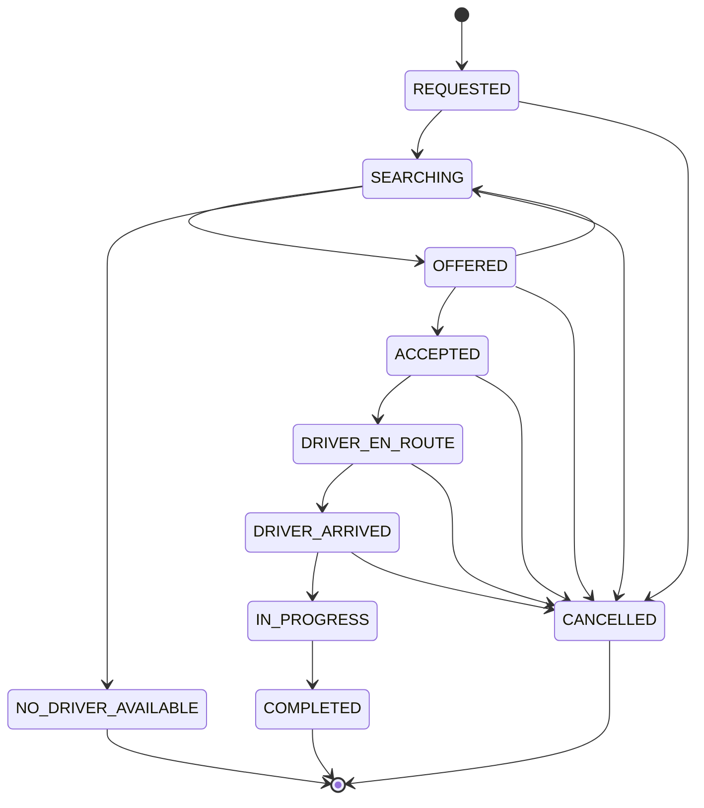
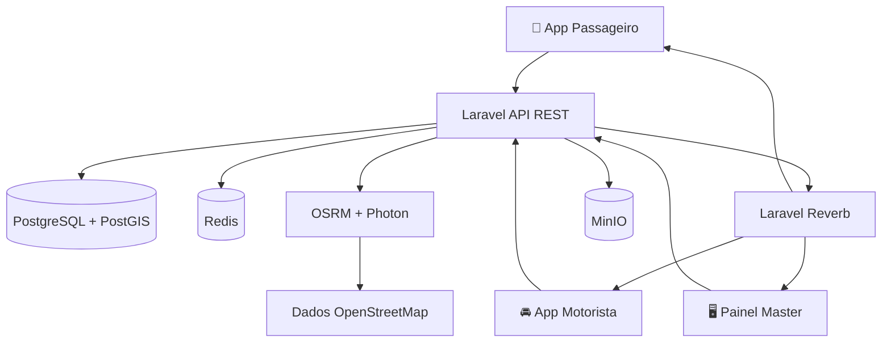

<div align="center">

<picture>
  <source media="(prefers-color-scheme: dark)" srcset="packages/design-tokens/assets/logo-fundo-escuro.png">
  <source media="(prefers-color-scheme: light)" srcset="packages/design-tokens/assets/logo-fundo-claro.png">
  
</picture>

### Mobilidade inteligente. Tecnologia que conecta caminhos.

**Ecossistema de mobilidade urbana para passageiros, motoristas e operação, com serviços geoespaciais open source e arquitetura preparada para Android e iOS.**


**[Visão geral](#visão-geral)** · **[Funcionalidades](#funcionalidades)** · **[Instalação](#início-rápido)** · **[Arquitetura](#arquitetura)** · **[Identidade visual](#identidade-visual)**

</div>

---

## ✨ Visão geral

A **VOZTRI** é uma plataforma de mobilidade urbana projetada para reunir solicitações de corridas, gestão de motoristas, operações em tempo real e controles financeiros em um único ecossistema.

Seu projeto técnico prioriza **autonomia sobre a infraestrutura de mapas**, **concorrência segura no despacho de corridas**, **rastreabilidade financeira** e **experiência mobile-first**. A proposta é oferecer uma alternativa tecnológica para o mercado brasileiro, com funcionalidades comparáveis às principais plataformas de mobilidade.

> [!IMPORTANT]
> Este README descreve a arquitetura e os recursos previstos na documentação do projeto. A existência de um recurso nesta lista não comprova, por si só, que ele já esteja implantado, homologado ou disponível em produção. Integrações, segurança, regras locais e exigências regulatórias precisam de validação antes do lançamento.

### Destaques da solução

| 🗺️ Mapas abertos | ⚡ Operação em tempo real | 🔐 Corridas seguras | 💳 Finanças rastreáveis |
|:---:|:---:|:---:|:---:|
| OpenStreetMap, OSRM, Photon e MapLibre | Redis, PostGIS e Laravel Reverb | PIN de embarque, máquina de estados e controle de aceite | Ledger de partidas dobradas com valores em centavos |

## 🧭 Sumário

- [Visão geral](#visão-geral)
- [Funcionalidades](#funcionalidades)
- [Arquitetura](#arquitetura)
- [Stack tecnológica](#stack-tecnológica)
- [Identidade visual](#identidade-visual)
- [Estrutura do monorepo](#estrutura-do-monorepo)
- [Início rápido](#início-rápido)
- [Serviços locais](#serviços-locais)
- [Testes e observabilidade](#testes-e-observabilidade)
- [Aplicativos Android e iOS](#aplicativos-android-e-ios)
- [Segurança e conformidade](#segurança-e-conformidade)
- [Documentação complementar](#documentação-complementar)
- [Licença](#licença)

---

## 📱 Funcionalidades

<details open>
<summary><b>🚕 Aplicativo do passageiro</b></summary>

- **Mapa interativo:** localização em tempo real, visualização de veículos e estimativas de chegada.
- **Categorias de viagem:** VozTri Pop, VozTri Black, VozTri Mulher e VozTri Moto.
- **Embarque por PIN:** código de quatro dígitos para validar o início da corrida.
- **Recursos de segurança:** central SOS e contatos de confiança previstos no fluxo da aplicação.
- **Avaliações e gorjetas:** nota de 1 a 5 estrelas, elogios e valores sugeridos.

</details>

<details open>
<summary><b>🚘 Aplicativo do motorista</b></summary>

- **Disponibilidade online/offline:** atualização de status e posição no índice geoespacial.
- **Painel de ganhos:** receitas, viagens realizadas e avaliação.
- **Ofertas de corrida:** janela de aceite com contagem regressiva e valor líquido estimado.
- **Navegação:** informações de manobra e validação do PIN de embarque.
- **Repasses:** extrato e fluxo projetado para solicitações de transferência via Pix, dependente de integração financeira.

</details>

<details open>
<summary><b>🖥️ Painel administrativo Master</b></summary>

- **Mapa operacional:** acompanhamento geográfico de motoristas e corridas.
- **Homologação:** análise de documentação, CNH com EAR e CRLV.
- **Tarifas:** configuração de preço base, por quilômetro e por minuto conforme a região.
- **Auditoria:** rastreamento de intervenções administrativas com IP e data/hora.

</details>

<details>
<summary><b>⚙️ Despacho, concorrência e ciclo da corrida</b></summary>

- **Busca concêntrica:** expansão de procura em raios de 2, 5, 8 e 12 km.
- **Controle de aceite:** locks distribuídos com Redis para evitar dupla atribuição.
- **Estados explícitos:** transições de corrida verificáveis e auditáveis.



</details>

<details>
<summary><b>💰 Financeiro e ledger</b></summary>

- **Precisão monetária:** representação por centavos inteiros (`amount_cents`).
- **Partidas dobradas:** lançamentos contábeis equilibrados.
- **Rastreabilidade:** ajustes realizados por lançamentos compensatórios, sem apagar o histórico.
- **Regra documentada:** exemplo de participação de 15% para a plataforma, sujeito à configuração comercial.

</details>

---

## 🏗️ Arquitetura



A arquitetura documentada combina **domínios de negócio em Laravel**, APIs REST, eventos por WebSocket, índices espaciais e persistência financeira. O uso de dados OSM e serviços cartográficos auto-hospedados reduz a dependência de APIs comerciais, mas **não elimina custos de infraestrutura, armazenamento, tráfego ou operação**.

## 🧰 Stack tecnológica

| Camada | Tecnologias |
|---|---|
| **Backend** | PHP 8.3, Laravel 12, Sanctum, Reverb |
| **Banco e geodados** | PostgreSQL 16, PostGIS 3.4 |
| **Cache e geolocalização** | Redis 7, índices GEO, Pub/Sub |
| **Apps móveis** | React Native 0.74, TypeScript, Zustand, Zod |
| **Mapas mobile/web** | MapLibre GL Native, MapLibre GL JS |
| **Painel administrativo** | React 18, Vite, Tailwind CSS |
| **Rotas e geocodificação** | OpenStreetMap, OSRM, Photon / Pelias |
| **Arquivos e mídia** | MinIO, compatibilidade S3 |
| **Infraestrutura** | Docker Compose, Nginx Alpine |
| **Testes e monitoramento** | Testes Laravel, k6, Prometheus |

---

## 🎨 Identidade visual

O design system **Urban Mobility Kinetic System** combina contrastes intensos, superfícies limpas e um gradiente violeta característico da VOZTRI.

<div align="center">
  
</div>

### Paleta oficial

| Cor | Hex | Uso |
|---|---|---|
| 🟣 Roxo principal | `#6A00FF` | Ações primárias e destaques |
| 🟪 Roxo escuro | `#4F00C3` | Superfícies e elementos de ênfase |
| 💜 Roxo claro | `#9B4DFF` | Gradientes e estados ativos |
| 🌸 Lavanda | `#C9B2FF` | Chips e interações secundárias |
| 🌑 Azul escuro | `#0B1026` | Fundo dark e navegação noturna |
| ⚪ Cinza claro | `#F4F6FA` | Superfícies claras |

**Tipografia:** Montserrat · Display 800 · Headline 700 · Título 600 · Corpo 400.

### Variações da marca

<div align="center">
  <picture>
    <source media="(prefers-color-scheme: dark)" srcset="packages/design-tokens/assets/icone-fundo-escuro.png">
    <source media="(prefers-color-scheme: light)" srcset="packages/design-tokens/assets/icone-fundo-claro.png">
    
  </picture>
</div>

> Os arquivos da marca usados neste documento devem estar em `packages/design-tokens/assets/` para que sejam exibidos corretamente no GitHub.

---

## 🗂️ Estrutura do monorepo

```text
voztri/
├── apps/
│   ├── passenger-mobile/           # React Native: passageiro
│   ├── driver-mobile/              # React Native: motorista
│   └── admin-web/                  # React + Vite: administração
├── backend/
│   ├── app/
│   │   ├── Domain/                # Entidades, enums e regras
│   │   ├── Application/           # Casos de uso e DTOs
│   │   ├── Infrastructure/        # PostGIS, Redis e gateways
│   │   ├── Http/                  # REST, validações e middlewares
│   │   └── Events/                # Eventos em tempo real
│   ├── database/                   # Migrations e seeders
│   ├── routes/                     # api.php, web.php, channels.php
│   └── tests/                      # Testes automatizados
├── packages/
│   ├── design-tokens/              # Marca, cores e tipografia
│   ├── shared-types/               # Tipos compartilhados
│   ├── validation/                 # Esquemas Zod
│   ├── localization/               # pt-BR, en-US, es-ES
│   ├── mobile-core/                # Código comum dos apps React Native (config, push, API, usePolling, kit de UI e login)
│   └── api-client/                 # Cliente HTTP
├── infrastructure/
│   ├── docker/
│   ├── nginx/
│   ├── maps/
│   ├── monitoring/
│   └── scripts/
├── docs/
├── docker-compose.yml
├── CONTEXTO.md
├── DOCUMENTACAO.md
└── PASSOS.md
```

---

## 🚀 Início rápido

### Pré-requisitos

- Git e Docker com Docker Compose.
- Recursos de CPU, RAM e armazenamento suficientes para serviços e dados de mapas.
- Android Studio para builds Android; macOS e Xcode para builds iOS.
- Configurações de ambiente e credenciais locais conforme `.env.example`.

### 1. Obtenha o código

```bash
git clone <URL_DO_SEU_REPOSITORIO>
cd voztri
```

### 2. Configure o ambiente

```bash
cp .env.example .env
```

> No Windows PowerShell, use `Copy-Item .env.example .env`.

### 3. Inicie os serviços

```bash
docker compose up -d --build
```

### 4. Inicialize o Laravel

O Laravel recebe as variáveis do `.env` da raiz pelo `env_file` do Compose; não existe `backend/.env`. Por isso o `php artisan key:generate` comum falha com `file_get_contents(/var/www/html/.env)`. Gere a chave com `--show` e grave-a no `.env` da raiz:

```bash
# 1. Gere a chave e copie a saída (base64:...)
docker compose exec app php artisan key:generate --show

# 2. Cole o valor em APP_KEY= no .env da raiz e recrie os contêineres PHP
#    (o env_file só é lido quando o contêiner é criado)
docker compose up -d --force-recreate app worker scheduler reverb

# 3. Rode as migrations e o seed
docker compose exec app php artisan migrate --seed

# 4. Atenção ao repetir o seed: o DatabaseSeeder só cria registros, sem 
# checar se eles já existem. Rodar migrate --seed de novo vai falhar por 
# telefone e e-mail duplicados. Para recomeçar do zero, use:
docker compose exec app php artisan migrate:fresh --seed
```

> [!WARNING]
> Não rode `php artisan config:cache` em desenvolvimento. Com a configuração em cache, o `phpunit.xml` deixa de valer, os testes passam a usar o banco `voztri_db` e o `RefreshDatabase` apaga os dados dele. Se já rodou, desfaça com `docker compose exec app php artisan config:clear`. Use `config:cache` só em produção.

<!-- -->

> [!NOTE]
> Os comandos consideram que o serviço PHP no `docker-compose.yml` se chama `app`. Ajuste o nome caso o Compose do seu ambiente seja diferente. Os dados cartográficos do OSRM podem exigir uma etapa de preparação documentada em `infrastructure/maps/`.

### 5. Suba o painel administrativo (admin-web)

O painel roda fora do Docker, com Node 20+. Instale as dependências do monorepo na raiz e suba o workspace do painel:

```bash
npm install
npm run dev -w @voztri/admin-web
```

Acesse `http://localhost:3010` e entre com o administrador do seed: telefone **(11) 99999-0000**, código **123456** (o OTP é fixo em desenvolvimento). O painel chama `/api/v1` na própria origem, e o proxy do Vite encaminha as chamadas para a API em `http://localhost:8080`, então não depende de CORS. A porta e o destino ficam configuráveis em `apps/admin-web/.env` (veja o `.env.example`).

> [!NOTE]
> Todos os apps usam `react@18.2.0`, a versão exata exigida pelo `react-native@0.74`. Não suba o React de um app isoladamente: o `npm install` voltaria a falhar com `ERESOLVE`. Os pacotes `@voztri/*` entram no painel pelo código-fonte, via aliases no `vite.config.ts` e no `tsconfig.json`.

### 6. Rode os apps mobile (driver-mobile e passenger-mobile)

Os projetos nativos seguem o template do React Native 0.74.7, ajustados para o monorepo (as dependências ficam no `node_modules` da raiz).

| App | Pacote / Bundle ID | Componente registrado | Nome exibido |
|---|---|---|---|
| `driver-mobile` | `br.com.voztri.driver` | `VoztriDriver` | VOZTRI Driver |
| `passenger-mobile` | `br.com.voztri.passenger` | `VoztriPassenger` | VOZTRI |

Os dois apps usam a API real (o backend do passo 3 precisa estar no ar). Login por código SMS com os usuários do seed, código `123456` em desenvolvimento:

| App | Telefone | Usuário |
|---|---|---|
| `driver-mobile` | (11) 99999-2222 | Carlos Eduardo Silva (motorista Pop, já online) |
| `passenger-mobile` | (11) 99999-1111 | Beatriz Lima (PIN de emergência 1234) |

O endereço da API fica em `src/config.ts` de cada app: `http://10.0.2.2:8080/api/v1` no emulador Android (o `localhost` da máquina) e `http://localhost:8080/api/v1` no simulador iOS. Em aparelho físico, troque pelo IP da máquina na rede. As ofertas e o andamento da corrida chegam por polling a cada 3 s; a sessão fica salva no aparelho (AsyncStorage).

**Localização (GPS):**

- **Passageiro:** o ponto de embarque é a posição do GPS, lida ao entrar no app, com o **endereço** obtido por geocodificação reversa (ex.: "Av. Paulista, 1578"; enquanto ele não chega, ou se o serviço falhar, aparece a coordenada). O **destino** é escolhido pela busca de endereços e lugares (digite pelo menos 3 letras, ex.: "aeroporto congonhas" ou "rua augusta 1500"), na região em volta do embarque. O geocodificador é o Photon, configurado em `PHOTON_GEOCODING_URL` (em dev, a instância pública `https://photon.komoot.io`; depois de mudar o `.env`, recrie os contêineres PHP). Sem permissão ou sem sinal, o app usa um endereço padrão, **avisa na tela inicial** e oferece "Usar minha localização" para tentar de novo. O SOS envia a posição do momento.
- **Motorista:** só fica online com a permissão de localização. Enquanto está online, o app envia a posição para `/driver/location` (na hora ao andar mais de 200 m; em movimento, no máximo a cada 10 s; **parado, a cada 2 min**, para a posição não envelhecer e o motorista não ir para o fim da fila), e o despacho oferece as corridas ao motorista mais próximo com posição recente (até 10 min).
- **Com o app em segundo plano ou a tela desligada**, o envio continua enquanto o motorista está online:
  - **Android:** pelo `LocationTrackingService`, um serviço nativo em primeiro plano com a notificação fixa "Você está online no VOZTRI Driver". Ele envia direto para a API (não depende do JavaScript) e para quando o motorista fica offline ou sai da conta, ou se a API responder 401/403/404. Se o motorista tirar o app da lista de recentes, o serviço continua, porque ele segue online.
  - **iOS:** pelo módulo nativo `VoztriLocationTracking` (`ios/VoztriDriver/VoztriLocationTracking.m`), que também envia direto para a API, com o GPS configurado para **não pausar com o motorista parado** (`pausesLocationUpdatesAutomatically = NO`, `activityType` de navegação automotiva e sem filtro de distância). Isso garante a chegada automática ao embarque com o carro esperando. O iOS mostra o indicador azul de localização. Se o módulo não iniciar, o app volta a enviar pelo JS em segundo plano.
  - Nas duas plataformas, e também no envio pelo JS (quando o serviço nativo não inicia), a leitura segurada pelo intervalo mínimo de 10 s é enviada assim que o intervalo vence, para a última posição antes de parar sempre chegar à API. Uma falha de rede reenvia a posição depois de um intervalo, mesmo sem leitura nova.
- **Permissões:** depois de ficar online, o app explica o motivo e pede à parte a localização em segundo plano: "Permitir o tempo todo" (`ACCESS_BACKGROUND_LOCATION`) no Android 10+ e "Sempre" no iOS. No Android 13+ também pede a permissão de notificação, para o aviso do serviço aparecer. Se o motorista recusar, o envio continua com o app aberto e, no Android, também pelo serviço iniciado com o app aberto.
- **Push de novas ofertas:** com o app do motorista em segundo plano ou fechado, cada oferta chega como notificação ("Nova corrida: R$ X", com o embarque e o tempo para responder), que expira junto com a oferta. Tocar abre o app já com a oferta. Ver [Ativando as notificações push](#ativando-as-notificações-push).
- **Push para o passageiro:** quando o motorista aceita, chega "Carlos está a caminho" (carro, placa e tempo estimado até o embarque); quando ele chega a **100 m do embarque** (detectado pela posição enviada, inclusive com o app em segundo plano, e só quando distância + precisão do GPS cabe nos 100 m), ou toca em **"Cheguei ao embarque"** a até 300 m, chega "Seu motorista chegou", e essa notificação substitui a anterior. O aviso manual feito mais longe é recusado com a distância ("Você está a 550 m do embarque..."). Tocar abre o acompanhamento da corrida. O motorista também pode validar o PIN direto, sem avisar a chegada. Se o **motorista cancelar**, chega "Corrida cancelada pelo motorista" (sem o motivo digitado); na **conclusão**, chega "Viagem concluída" com o total e a forma de pagamento, e tocar abre a avaliação. Se a busca passar de **3 minutos** sem motorista, ela é encerrada e chega "Nenhum motorista disponível" (uma oferta em andamento nesse momento não é interrompida). Na tela de busca, um **contador regressivo** mostra o prazo (o prazo vem pronto da API em `searchExpiresAt`, e o relógio do aparelho é corrigido pelo header `Date` das respostas, então funciona com o relógio adiantado ou atrasado); quando a busca termina sem motorista, a tela mostra o aviso com **"Tentar de novo"**, que refaz a solicitação com a mesma origem, destino, categoria e pagamento, e "Voltar ao início".
- **Emulador Android:** a posição padrão do emulador fica nos Estados Unidos. Defina uma posição em São Paulo em *Extended controls → Location* (por exemplo, `-23.561414, -46.655881`), senão as estimativas calculam a distância até lá. No simulador iOS: *Features → Location → Custom Location*.

**Android** (JDK 17+, Android SDK 34 e um emulador ou aparelho com depuração USB):

```bash
# Terminal 1: Metro na pasta do app, na porta 8082 (a 8081 é do Reverb no docker-compose)
cd apps/driver-mobile && npx react-native start --port 8082

# Terminal 2: compila, instala e abre o app apontando para o Metro na 8082
cd apps/driver-mobile && npx react-native run-android --port 8082
# ou, só pelo Gradle: cd android && ./gradlew installDebug -PreactNativeDevServerPort=8082
```

> **Por que `--port` também no `run-android`:** no emulador o app procura o Metro em `10.0.2.2:<porta>`, a porta da máquina, e não em `localhost`. Por isso `adb reverse tcp:8081 tcp:8082` não resolve: a porta precisa estar no APK, e é isso que o `--port` (ou `-PreactNativeDevServerPort`) grava. Sem ela, o app tenta a 8081, cai no Reverb e mostra "Unable to load script".
>
> **Depois de mudar o backend, reinicie o worker** (`docker compose restart worker`): o `queue:work` carrega o código uma vez e continua rodando a versão antiga, então jobs novos (push, timeout da busca) falham até o reinício.

Para só gerar o APK de debug: `cd apps/driver-mobile/android && ./gradlew assembleDebug` (saída em `app/build/outputs/apk/debug/app-debug.apk`). O build de release usa a keystore definida em `VOZTRI_RELEASE_STORE_FILE`, `VOZTRI_RELEASE_STORE_PASSWORD`, `VOZTRI_RELEASE_KEY_ALIAS` e `VOZTRI_RELEASE_KEY_PASSWORD` (em `~/.gradle/gradle.properties`, nunca no repositório).

**iOS** (somente macOS, com Xcode e CocoaPods):

```bash
cd apps/driver-mobile
bundle install                          # instala a versão de CocoaPods fixada no Gemfile
cd ios && bundle exec pod install && cd ..
npx react-native run-ios
```

#### Testando num aparelho físico (`VOZTRI_API_URL`)

Por padrão os apps chamam a API em `http://10.0.2.2:8080/api/v1` (emulador Android) ou `http://localhost:8080/api/v1` (simulador iOS). Num aparelho, defina `VOZTRI_API_URL` com o endereço da máquina na rede, **sem editar o código**. O valor é embutido no JavaScript na hora do bundle (Babel), então vale para a sessão do Metro ou para o build em que foi definido.

```bash
# Debug (o app carrega o JavaScript do Metro): defina ao subir o Metro
VOZTRI_API_URL=http://192.168.0.10:8080/api/v1 npx react-native start

# Android por USB, sem depender do IP: o aparelho acessa a porta 8080 da máquina
adb reverse tcp:8080 tcp:8080
VOZTRI_API_URL=http://localhost:8080/api/v1 npx react-native start

# Release Android: exporte antes do Gradle (o bundle é refeito quando o valor muda)
VOZTRI_API_URL=https://api.exemplo.com.br/api/v1 ./gradlew assembleRelease

# Release iOS: o Xcode lê ios/.xcode.env.local (fora do git)
echo 'export VOZTRI_API_URL=https://api.exemplo.com.br/api/v1' >> ios/.xcode.env.local
```

Por USB, o Metro também precisa do `adb reverse` da porta dele (ex.: `adb reverse tcp:8082 tcp:8082`), porque o app no aparelho procura o Metro em `localhost`. Com o passageiro no aparelho e o motorista no emulador ao mesmo tempo, use um Metro por app em portas diferentes (ex.: 8082 e 8083, com o mesmo `-PreactNativeDevServerPort` no `installDebug`) e, com mais de um aparelho conectado, escolha o alvo com `ANDROID_SERIAL`. Em celulares Xiaomi (MIUI), a instalação por USB precisa ser confirmada no aparelho (sem isso: `INSTALL_FAILED_USER_RESTRICTED`). O despacho só procura motoristas a até 12 km do embarque: leve o GPS do emulador para perto do celular (`adb emu geo fix <longitude> <latitude>`).

No PowerShell: `$env:VOZTRI_API_URL = 'http://192.168.0.10:8080/api/v1'` antes do comando. O valor precisa começar com `http://` ou `https://` (a barra final é removida); se for inválido, o app avisa no console e usa o padrão. Trocar o valor não exige `--reset-cache`: ele entra na chave do cache do Metro e nas entradas da tarefa de bundle do Gradle. Fora do debug, o Android bloqueia HTTP sem TLS: use HTTPS no release.

#### Ativando as notificações push

O push está implementado nos dois apps, mas **desligado até as credenciais do Firebase serem adicionadas**: sem elas o backend só registra no log e os apps compilam e rodam normalmente (ofertas e andamento da corrida seguem pelo polling). Os arquivos abaixo estão no `.gitignore`.

1. Crie um projeto no [console do Firebase](https://console.firebase.google.com) e adicione quatro apps: **Android** `br.com.voztri.driver` e `br.com.voztri.passenger`, e **iOS** com os mesmos bundle ids.
2. **Android:** baixe o `google-services.json` de cada app para `apps/driver-mobile/android/app/` e `apps/passenger-mobile/android/app/`. O Gradle aplica o plugin `google-services` só quando o arquivo existe.
3. **iOS:** baixe o `GoogleService-Info.plist` de cada app, arraste-o para o grupo `VoztriDriver` / `VoztriPassenger` no Xcode (marcando o target), e envie a chave de APNs (`.p8`, em *Apple Developer → Keys*) em *Firebase → Configurações do projeto → Cloud Messaging*. A capability Push Notifications já está nos entitlements (`aps-environment`); confirme o time de assinatura no Xcode.
4. **Backend:** em *Firebase → Configurações do projeto → Contas de serviço*, gere uma chave privada e salve como `backend/storage/app/firebase/service-account.json`. No `.env` da raiz: `FCM_CREDENTIALS=/var/www/html/storage/app/firebase/service-account.json`. Recrie os contêineres PHP (`docker compose up -d --force-recreate app worker`). O envio roda na fila, então o `worker` precisa estar no ar.
5. Recompile os apps (`run-android` / `pod install` + `run-ios`), entre como motorista e como passageiro e confira os registros em `user_devices`.

**Testes das telas** (Jest com o preset `react-native`, sem precisar de emulador):

```bash
npm test -w @voztri/driver-mobile
npm test -w @voztri/passenger-mobile
npm test -w @voztri/mobile-core   # código comum: push, sessão, API, erros, config e login
```

Os testes substituem a camada de API por mocks e percorrem o fluxo completo de cada app (login, oferta, aceite, PIN, finalização, ganhos e repasse no motorista; destino, estimativa, pagamento, busca, chat, SOS e avaliação no passageiro), verificando as chamadas feitas à API e a reação a cada resposta (PIN errado, oferta expirada, corrida cancelada, sem conexão). A cada passo, falham se algum texto estiver fora de um `<Text>`, erro que derruba o app no dispositivo.

## 🌐 Serviços locais

| Serviço | Endereço de desenvolvimento | Finalidade |
|---|---|---|
| API REST v1 | `http://localhost:8080/api/v1` | Autenticação e corridas |
| Admin web | `http://localhost:3010` | Gestão operacional (login: (11) 99999-0000 / 123456) |
| Laravel Reverb | `ws://localhost:8081` | Eventos por WebSocket |
| PostgreSQL / PostGIS | `localhost:5434` | Persistência geoespacial |
| Redis | `localhost:6380` | Cache e posição de motoristas |
| Mailpit (SMTP) | `localhost:1026` | Recebimento de e-mails em desenvolvimento |
| Mailpit (interface) | `http://localhost:8026` | Visualização de e-mails em desenvolvimento |
| MinIO (API S3) | `http://localhost:9010` | Armazenamento de objetos |
| MinIO Console | `http://localhost:9011` | Gestão de objetos e documentos |

Sem porta exposta, dois contêineres rodam o trabalho em segundo plano do Laravel: o `worker` (`queue:work`, executa os jobs da fila: push, timeout da busca) e o `scheduler` (`schedule:work`, dispara as tarefas agendadas de `backend/routes/console.php`, como a limpeza diária do histórico de destinos com mais de 90 dias, e as coloca na fila do `worker`). Em produção, o `scheduler` equivale a um cron com `php artisan schedule:run` a cada minuto.

As portas do host saem das variáveis `FORWARD_*` do `.env` e foram escolhidas para não conflitar com outros stacks locais que usam as portas padrão (5432, 6379, 9000/9001, 1025/8025). Entre os contêineres, a comunicação continua pelas portas internas (`postgres:5432`, `redis:6379`, `minio:9000`, `mailpit:1025`).

---

## 🧪 Testes e observabilidade

### Testes automatizados

```bash
# Suíte completa (Unit + Feature)
docker compose exec app vendor/bin/phpunit

# Ledger e consistência financeira
docker compose exec app vendor/bin/phpunit --filter=LedgerServiceTest

# Transições de estados de corrida
docker compose exec app vendor/bin/phpunit --filter=RideStateMachineTest

# Concorrência e aceite seguro
docker compose exec app vendor/bin/phpunit --filter=ConcurrencyAndSecurityTest
```

Os testes de feature usam o banco PostgreSQL **`voztri_test`**, configurado em `backend/phpunit.xml` e isolado do banco de desenvolvimento, com `RefreshDatabase`. Ele é criado automaticamente na primeira subida de um volume novo do Postgres. Se o volume já existia antes, crie-o uma vez:

```bash
docker compose exec -T postgres psql -U voztri_user -d voztri_db < infrastructure/docker/postgres-init/01-create-test-database.sql
```

### Teste de carga

```bash
k6 run infrastructure/monitoring/k6-load-test.js
```

A documentação prevê um cenário de **100 solicitações simultâneas**. A capacidade efetiva deve ser medida em ambiente equivalente ao de produção; não é inferida apenas pela existência do script.

---

## 📦 Aplicativos Android e iOS

### Android

```bat
:: Windows
infrastructure\scripts\build-android.bat
```

```bash
# Linux / macOS
chmod +x infrastructure/scripts/build-android.sh
./infrastructure/scripts/build-android.sh
```

Os builds Android foram planejados com **Hermes** e **ProGuard**; valide configurações de assinatura, permissões e geração dos artefatos APK/AAB no ambiente de release.

### iOS

A arquitetura React Native permite preparar o aplicativo para iOS, mas a compilação e publicação exigem configuração específica no **macOS com Xcode**, certificados e perfis de assinatura.

Consulte: [`docs/guia-build-ios.md`](docs/guia-build-ios.md).

---

## 🛡️ Segurança e conformidade

A solução foi concebida considerando requisitos brasileiros de mobilidade e proteção de dados:

- **Mobilidade regulamentada:** observar a Lei nº 13.640/2018 e as regras municipais pertinentes; verificar documentação, habilitação com EAR, seguros e demais requisitos aplicáveis.
- **LGPD:** limitar acesso a dados pessoais, definir retenção, políticas de privacidade e critérios para coleta de localização.
- **Segurança das corridas:** PIN de embarque, controles de estado e trilhas de auditoria.
- **Integridade financeira:** transações em centavos inteiros e registros compensatórios auditáveis.
- **Operação confiável:** autenticação por token, validação de requisições, controles de concorrência e monitoramento.

> [!WARNING]
> A conformidade legal e a segurança operacional dependem de implementação, testes, processos e avaliação jurídica. Recursos como SOS, repasses Pix e monitoramento em tempo real não devem ser anunciados como garantidos sem validação ponta a ponta.

---

## 📚 Documentação complementar

| Documento | Conteúdo |
|---|---|
| [`CONTEXTO.md`](CONTEXTO.md) | Visão geral e contexto evolutivo do projeto |
| [`DOCUMENTACAO.md`](DOCUMENTACAO.md) | Especificações técnicas e endpoints |
| [`PASSOS.md`](PASSOS.md) | Histórico das fases de implementação |
| [`docs/guia-build-ios.md`](docs/guia-build-ios.md) | Guia de compilação e preparação iOS |
| [`infrastructure/maps/`](infrastructure/maps/) | Configuração dos dados e serviços cartográficos |

## 📄 Licença

**Software proprietário — VOZTRI Tecnologia em Mobilidade Urbana. Todos os direitos reservados.**

Não é concedida licença de uso, modificação ou redistribuição por meio deste README. Consulte os responsáveis pelo projeto para obter autorização.

---

<div align="center">

**VOZTRI · Mobilidade Urbana**

*Tecnologia para conectar pessoas, trajetos e oportunidades.*

</div>
