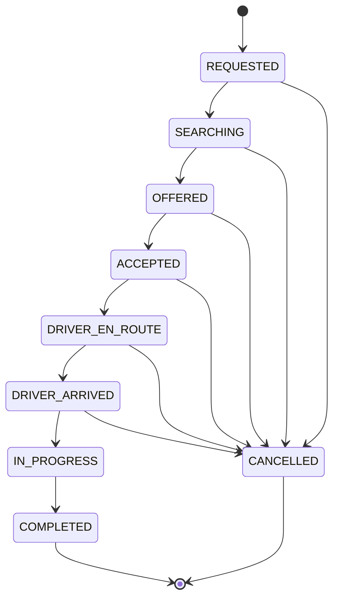
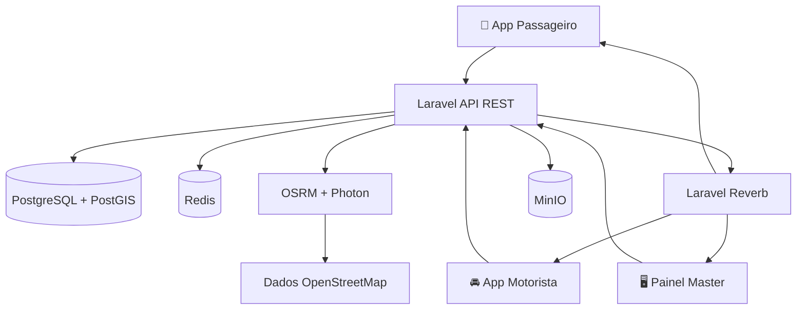

<div align="center">

<picture>
  <source media="(prefers-color-scheme: dark)" srcset="packages/design-tokens/assets/logo-fundo-escuro.png">
  <source media="(prefers-color-scheme: light)" srcset="packages/design-tokens/assets/logo-fundo-claro.png">
  
</picture>

### Mobilidade inteligente. Tecnologia que conecta caminhos.

**Ecossistema de mobilidade urbana para passageiros, motoristas e operação, com serviços geoespaciais open source e arquitetura preparada para Android e iOS.**


**[Visão geral](#visão-geral)** · **[Funcionalidades](#funcionalidades)** · **[Instalação](#início-rápido)** · **[Arquitetura](#arquitetura)** · **[Identidade visual](#identidade-visual)**

</div>

---

## ✨ Visão geral

A **VOZTRI** é uma plataforma de mobilidade urbana projetada para reunir solicitações de corridas, gestão de motoristas, operações em tempo real e controles financeiros em um único ecossistema.

Seu projeto técnico prioriza **autonomia sobre a infraestrutura de mapas**, **concorrência segura no despacho de corridas**, **rastreabilidade financeira** e **experiência mobile-first**. A proposta é oferecer uma alternativa tecnológica para o mercado brasileiro, com funcionalidades comparáveis às principais plataformas de mobilidade.

> [!IMPORTANT]
> Este README descreve a arquitetura e os recursos previstos na documentação do projeto. A existência de um recurso nesta lista não comprova, por si só, que ele já esteja implantado, homologado ou disponível em produção. Integrações, segurança, regras locais e exigências regulatórias precisam de validação antes do lançamento.

### Destaques da solução

| 🗺️ Mapas abertos | ⚡ Operação em tempo real | 🔐 Corridas seguras | 💳 Finanças rastreáveis |
|:---:|:---:|:---:|:---:|
| OpenStreetMap, OSRM, Photon e MapLibre | Redis, PostGIS e Laravel Reverb | PIN de embarque, máquina de estados e controle de aceite | Ledger de partidas dobradas com valores em centavos |

## 🧭 Sumário

- [Visão geral](#visão-geral)
- [Funcionalidades](#funcionalidades)
- [Arquitetura](#arquitetura)
- [Stack tecnológica](#stack-tecnológica)
- [Identidade visual](#identidade-visual)
- [Estrutura do monorepo](#estrutura-do-monorepo)
- [Início rápido](#início-rápido)
- [Serviços locais](#serviços-locais)
- [Testes e observabilidade](#testes-e-observabilidade)
- [Aplicativos Android e iOS](#aplicativos-android-e-ios)
- [Segurança e conformidade](#segurança-e-conformidade)
- [Documentação complementar](#documentação-complementar)
- [Licença](#licença)

---

## 📱 Funcionalidades

<details open>
<summary><b>🚕 Aplicativo do passageiro</b></summary>

- **Mapa interativo:** localização em tempo real, visualização de veículos e estimativas de chegada.
- **Categorias de viagem:** VozTri Pop, VozTri Black, VozTri Mulher e VozTri Moto.
- **Embarque por PIN:** código de quatro dígitos para validar o início da corrida.
- **Recursos de segurança:** central SOS e contatos de confiança previstos no fluxo da aplicação.
- **Avaliações e gorjetas:** nota de 1 a 5 estrelas, elogios e valores sugeridos.

</details>

<details open>
<summary><b>🚘 Aplicativo do motorista</b></summary>

- **Disponibilidade online/offline:** atualização de status e posição no índice geoespacial.
- **Painel de ganhos:** receitas, viagens realizadas e avaliação.
- **Ofertas de corrida:** janela de aceite com contagem regressiva e valor líquido estimado.
- **Navegação:** informações de manobra e validação do PIN de embarque.
- **Repasses:** extrato e fluxo projetado para solicitações de transferência via Pix, dependente de integração financeira.

</details>

<details open>
<summary><b>🖥️ Painel administrativo Master</b></summary>

- **Mapa operacional:** acompanhamento geográfico de motoristas e corridas.
- **Homologação:** análise de documentação, CNH com EAR e CRLV.
- **Tarifas:** configuração de preço base, por quilômetro e por minuto conforme a região.
- **Auditoria:** rastreamento de intervenções administrativas com IP e data/hora.

</details>

<details>
<summary><b>⚙️ Despacho, concorrência e ciclo da corrida</b></summary>

- **Busca concêntrica:** expansão de procura em raios de 2, 5, 8 e 12 km.
- **Controle de aceite:** locks distribuídos com Redis para evitar dupla atribuição.
- **Estados explícitos:** transições de corrida verificáveis e auditáveis.



</details>

<details>
<summary><b>💰 Financeiro e ledger</b></summary>

- **Precisão monetária:** representação por centavos inteiros (`amount_cents`).
- **Partidas dobradas:** lançamentos contábeis equilibrados.
- **Rastreabilidade:** ajustes realizados por lançamentos compensatórios, sem apagar o histórico.
- **Regra documentada:** exemplo de participação de 15% para a plataforma, sujeito à configuração comercial.

</details>

---

## 🏗️ Arquitetura



A arquitetura documentada combina **domínios de negócio em Laravel**, APIs REST, eventos por WebSocket, índices espaciais e persistência financeira. O uso de dados OSM e serviços cartográficos auto-hospedados reduz a dependência de APIs comerciais, mas **não elimina custos de infraestrutura, armazenamento, tráfego ou operação**.

## 🧰 Stack tecnológica

| Camada | Tecnologias |
|---|---|
| **Backend** | PHP 8.3, Laravel 11, Sanctum, Reverb |
| **Banco e geodados** | PostgreSQL 16, PostGIS 3.4 |
| **Cache e geolocalização** | Redis 7, índices GEO, Pub/Sub |
| **Apps móveis** | React Native 0.74, TypeScript, Zustand, Zod |
| **Mapas mobile/web** | MapLibre GL Native, MapLibre GL JS |
| **Painel administrativo** | React 18, Vite, Tailwind CSS |
| **Rotas e geocodificação** | OpenStreetMap, OSRM, Photon / Pelias |
| **Arquivos e mídia** | MinIO, compatibilidade S3 |
| **Infraestrutura** | Docker Compose, Nginx Alpine |
| **Testes e monitoramento** | Testes Laravel, k6, Prometheus |

---

## 🎨 Identidade visual

O design system **Urban Mobility Kinetic System** combina contrastes intensos, superfícies limpas e um gradiente violeta característico da VOZTRI.

<div align="center">
  
</div>

### Paleta oficial

| Cor | Hex | Uso |
|---|---|---|
| 🟣 Roxo principal | `#6A00FF` | Ações primárias e destaques |
| 🟪 Roxo escuro | `#4F00C3` | Superfícies e elementos de ênfase |
| 💜 Roxo claro | `#9B4DFF` | Gradientes e estados ativos |
| 🌸 Lavanda | `#C9B2FF` | Chips e interações secundárias |
| 🌑 Azul escuro | `#0B1026` | Fundo dark e navegação noturna |
| ⚪ Cinza claro | `#F4F6FA` | Superfícies claras |

**Tipografia:** Montserrat · Display 800 · Headline 700 · Título 600 · Corpo 400.

### Variações da marca

<div align="center">
  <picture>
    <source media="(prefers-color-scheme: dark)" srcset="packages/design-tokens/assets/icone-fundo-escuro.png">
    <source media="(prefers-color-scheme: light)" srcset="packages/design-tokens/assets/icone-fundo-claro.png">
    
  </picture>
</div>

> Os arquivos da marca usados neste documento devem estar em `packages/design-tokens/assets/` para que sejam exibidos corretamente no GitHub.

---

## 🗂️ Estrutura do monorepo

```text
voztri/
├── apps/
│   ├── passenger-mobile/           # React Native: passageiro
│   ├── driver-mobile/              # React Native: motorista
│   └── admin-web/                  # React + Vite: administração
├── backend/
│   ├── app/
│   │   ├── Domain/                # Entidades, enums e regras
│   │   ├── Application/           # Casos de uso e DTOs
│   │   ├── Infrastructure/        # PostGIS, Redis e gateways
│   │   ├── Http/                  # REST, validações e middlewares
│   │   └── Events/                # Eventos em tempo real
│   ├── database/                   # Migrations e seeders
│   ├── routes/                     # api.php, web.php, channels.php
│   └── tests/                      # Testes automatizados
├── packages/
│   ├── design-tokens/              # Marca, cores e tipografia
│   ├── shared-types/               # Tipos compartilhados
│   ├── validation/                 # Esquemas Zod
│   ├── localization/               # pt-BR, en-US, es-ES
│   └── api-client/                 # Cliente HTTP
├── infrastructure/
│   ├── docker/
│   ├── nginx/
│   ├── maps/
│   ├── monitoring/
│   └── scripts/
├── docs/
├── docker-compose.yml
├── CONTEXTO.md
├── DOCUMENTACAO.md
└── PASSOS.md
```

---

## 🚀 Início rápido

### Pré-requisitos

- Git e Docker com Docker Compose.
- Recursos de CPU, RAM e armazenamento suficientes para serviços e dados de mapas.
- Android Studio para builds Android; macOS e Xcode para builds iOS.
- Configurações de ambiente e credenciais locais conforme `.env.example`.

### 1. Obtenha o código

```bash
git clone <URL_DO_SEU_REPOSITORIO>
cd voztri
```

### 2. Configure o ambiente

```bash
cp .env.example .env
```

> No Windows PowerShell, use `Copy-Item .env.example .env`.

### 3. Inicie os serviços

```bash
docker compose up -d --build
```

### 4. Inicialize o Laravel

```bash
docker compose exec app php artisan key:generate
docker compose exec app php artisan migrate --seed
docker compose exec app php artisan config:cache
```

> [!NOTE]
> Os comandos consideram que o serviço PHP no `docker-compose.yml` se chama `app`. Ajuste o nome caso o Compose do seu ambiente seja diferente. Os dados cartográficos do OSRM podem exigir uma etapa de preparação documentada em `infrastructure/maps/`.

## 🌐 Serviços locais

| Serviço | Endereço de desenvolvimento | Finalidade |
|---|---|---|
| API REST v1 | `http://localhost:8080/api/v1` | Autenticação e corridas |
| Admin web | `http://localhost:3000` | Gestão operacional |
| Laravel Reverb | `ws://localhost:8081` | Eventos por WebSocket |
| PostgreSQL / PostGIS | `localhost:5432` | Persistência geoespacial |
| Redis | `localhost:6379` | Cache e posição de motoristas |
| Mailpit | `http://localhost:8025` | Visualização de e-mails em desenvolvimento |
| MinIO Console | `http://localhost:9001` | Gestão de objetos e documentos |

As portas representam a configuração descrita no projeto e podem variar conforme o arquivo Compose e o `.env`.

---

## 🧪 Testes e observabilidade

### Testes automatizados

```bash
# Ledger e consistência financeira
docker compose exec app php artisan test --filter=LedgerServiceTest

# Transições de estados de corrida
docker compose exec app php artisan test --filter=RideStateMachineTest

# Concorrência e aceite seguro
docker compose exec app php artisan test --filter=ConcurrencyAndSecurityTest
```

### Teste de carga

```bash
k6 run infrastructure/monitoring/k6-load-test.js
```

A documentação prevê um cenário de **100 solicitações simultâneas**. A capacidade efetiva deve ser medida em ambiente equivalente ao de produção; não é inferida apenas pela existência do script.

---

## 📦 Aplicativos Android e iOS

### Android

```bat
:: Windows
infrastructure\scripts\build-android.bat
```

```bash
# Linux / macOS
chmod +x infrastructure/scripts/build-android.sh
./infrastructure/scripts/build-android.sh
```

Os builds Android foram planejados com **Hermes** e **ProGuard**; valide configurações de assinatura, permissões e geração dos artefatos APK/AAB no ambiente de release.

### iOS

A arquitetura React Native permite preparar o aplicativo para iOS, mas a compilação e publicação exigem configuração específica no **macOS com Xcode**, certificados e perfis de assinatura.

Consulte: [`docs/guia-build-ios.md`](docs/guia-build-ios.md).

---

## 🛡️ Segurança e conformidade

A solução foi concebida considerando requisitos brasileiros de mobilidade e proteção de dados:

- **Mobilidade regulamentada:** observar a Lei nº 13.640/2018 e as regras municipais pertinentes; verificar documentação, habilitação com EAR, seguros e demais requisitos aplicáveis.
- **LGPD:** limitar acesso a dados pessoais, definir retenção, políticas de privacidade e critérios para coleta de localização.
- **Segurança das corridas:** PIN de embarque, controles de estado e trilhas de auditoria.
- **Integridade financeira:** transações em centavos inteiros e registros compensatórios auditáveis.
- **Operação confiável:** autenticação por token, validação de requisições, controles de concorrência e monitoramento.

> [!WARNING]
> A conformidade legal e a segurança operacional dependem de implementação, testes, processos e avaliação jurídica. Recursos como SOS, repasses Pix e monitoramento em tempo real não devem ser anunciados como garantidos sem validação ponta a ponta.

---

## 📚 Documentação complementar

| Documento | Conteúdo |
|---|---|
| [`CONTEXTO.md`](CONTEXTO.md) | Visão geral e contexto evolutivo do projeto |
| [`DOCUMENTACAO.md`](DOCUMENTACAO.md) | Especificações técnicas e endpoints |
| [`PASSOS.md`](PASSOS.md) | Histórico das fases de implementação |
| [`docs/guia-build-ios.md`](docs/guia-build-ios.md) | Guia de compilação e preparação iOS |
| [`infrastructure/maps/`](infrastructure/maps/) | Configuração dos dados e serviços cartográficos |

## 📄 Licença

**Software proprietário — VOZTRI Tecnologia em Mobilidade Urbana. Todos os direitos reservados.**

Não é concedida licença de uso, modificação ou redistribuição por meio deste README. Consulte os responsáveis pelo projeto para obter autorização.

---

<div align="center">

**VOZTRI · Mobilidade Urbana**

*Tecnologia para conectar pessoas, trajetos e oportunidades.*

</div>
